# AdaptLearn Technical & Architectural Code Documentation
## Statement 2: Personalized Tutoring with Adaptive Learning

---

## 1. System Overview & Core Pillars

AdaptLearn is an academic AI study companion designed to solve the problem of fragmented student study materials (scattered across textbooks, lecture slides, and video archives) and untrustworthy AI hallucinations. 

The architecture is built on five core pillars:
1. **Multimodal Knowledge Ingestion:** Zero-preprocessing ingestion of textbook PDFs, slide decks, and lecture videos with origin tracking (page numbers, slide indices, video timestamps) and diagram extraction.
2. **Source Grounding & Doubt Engine:** Strict citation verification (`[CLRS p. 28]`, `[Unit 2 Slides, Slide 14]`) with off-material rejection, bilingual explanations (English & Hinglish), and text-to-speech audio synthesis.
3. **Adaptive Assessment:** Real-time difficulty adjustment across Foundational, Intermediate, Advanced, and Expert tiers based on live streaks and response latency.
4. **Bayesian Learner Model (BKT):** Dynamic mastery estimation calculating $P(L_t)$ on every question with diagnostic intake calibration for new students.
5. **System Evaluation Framework:** Quantitative evaluation using RAGAS/DeepEval standards (Faithfulness, Relevancy, Context Precision/Recall) and multi-session student profile simulation.

---

## 2. Architecture & Data Flow

```mermaid
flowchart TD
    subgraph UI ["User Interface Layer"]
        LS["LoginScreen (Auth Gate)"]
        NAV["Navbar (Search, Theme, Logout)"]
        SIDE["Sidebar Navigation"]
        DASH["Dashboard Overview"]
        INGEST["Multimodal Ingestion Hub"]
        TUTOR["Source-Grounded AI Tutor"]
        SUBJ["Curriculum & Unit Explorer"]
        TREE["Visual Skill Tree (Course Flow)"]
        QUIZ["Adaptive Quiz Modal"]
        REV["Revision Hub (Flashcards, Schedule)"]
        ANALYTICS["Analytics & Mastery Dashboard"]
        EVAL["System Evaluation (RAGAS)"]
    end

    subgraph State ["Central State Management"]
        CTX["AppContext (src/context/AppContext.jsx)"]
    end

    subgraph Engines ["Computational Engines & Services"]
        BKT["BKT Engine (bktEngine.js)"]
        ADAPT["Adaptive Difficulty Engine (adaptiveEngine.js)"]
        DOUBT["Academic Doubt Engine (tutorKnowledgeBase.js)"]
        STORAGE["User-Scoped Storage & Supabase Client (supabase.js)"]
    end

    subgraph Data ["Knowledge Bases & Storage"]
        CURR["Curriculum Data (curriculumData.js)"]
        SOURCES["Multimodal Sources (multimodalSources.js)"]
        LOCAL["User-Scoped LocalStorage (Offline)"]
        CLOUD["Supabase PostgreSQL Cloud DB"]
    end

    LS -->|Authenticate| CTX
    CTX --> UI
    UI --> CTX
    CTX --> BKT
    CTX --> ADAPT
    TUTOR --> DOUBT
    TUTOR --> SOURCES
    QUIZ --> BKT
    QUIZ --> ADAPT
    CTX --> STORAGE
    STORAGE --> LOCAL
    STORAGE -.->|Optional Cloud Sync| CLOUD
    SUBJ --> CURR
    TREE --> CURR
```



---

## 3. Directory & File Structure

```
personalized-tutoring/
├── index.html                      # HTML root, Google Fonts (Inter, JetBrains Mono)
├── package.json                    # Dependencies: React 19, Lucide, Supabase, Confetti
├── vercel.json                     # Vercel single-page app rewrite configuration
├── vite.config.js                  # Vite bundler configuration
├── supabase-schema.sql             # PostgreSQL schema with RLS and index definitions
├── README.md                       # High-level project summary and quickstart
├── CODE_DOCUMENTATION.md           # This comprehensive technical specification
├── src/
│   ├── main.jsx                    # React entry point with AppProvider wrapper
│   ├── App.jsx                     # Root router gating access behind LoginScreen
│   ├── index.css                   # Design tokens, themes (light/dark), card styles
│   │
│   ├── context/
│   │   └── AppContext.jsx          # Global state (user, active view, mastery, quiz history)
│   │
│   ├── services/
│   │   ├── bktEngine.js            # Bayesian Knowledge Tracing & RAGAS simulation logic
│   │   ├── adaptiveEngine.js       # Dynamic difficulty & next best action algorithms
│   │   ├── tutorKnowledgeBase.js   # Academic doubt resolution knowledge engine
│   │   └── supabase.js             # User authentication & user-scoped data persistence
│   │
│   ├── data/
│   │   ├── curriculumData.js       # Syllabus, units, topics, questions, code blueprints
│   │   └── multimodalSources.js    # Origin-anchored excerpts (textbooks, slides, videos)
│   │
│   └── components/
│       ├── LoginScreen.jsx         # Mandatory login gate with demo account switchers
│       ├── Navbar.jsx              # Universal search dropdown, bookmarks, profile & logout
│       ├── Sidebar.jsx             # Navigation sidebar with status badges and streak count
│       ├── DashboardOverview.jsx   # Main overview with recommendations and workbench links
│       ├── DepartmentSemesterSelector.jsx # Department & semester pills
│       ├── SubjectExplorer.jsx     # Unit 1 to 5 linear syllabus catalog
│       ├── TopicLearningView.jsx   # Theoretical notes, code blueprints, and pitfalls
│       ├── CourseFlowPrerequisiteMap.jsx # Interactive Visual RPG-style Skill Tree
│       ├── AdaptiveQuizModal.jsx   # Real-time difficulty shifting MCQ assessment
│       ├── SourceGroundedTutorChat.jsx # Cited AI tutor with Hinglish & voice readout
│       ├── MultimodalIngestionHub.jsx # Upload simulator for books, slides, and videos
│       ├── RevisionHub.jsx         # Active recall flashcards & forgetting curve planner
│       ├── AnalyticsDashboard.jsx  # Strength/weakness diagnostics & mastery spectrum
│       ├── SystemEvaluationDashboard.jsx # RAGAS benchmark metrics & student simulation
│       ├── QuizHistoryView.jsx     # Historical attempt records and question inspector
│       ├── BookmarksView.jsx       # Saved topics and cheat sheets
│       ├── AuthModal.jsx           # Profile editing modal
│       ├── SettingsModal.jsx       # Supabase credentials and data export JSON
│       └── DiagnosticIntakeModal.jsx # Intake calibration for new students
```

---

## 4. Algorithmic Specifications

### 4.1. Bayesian Knowledge Tracing (BKT) (`src/services/bktEngine.js`)

AdaptLearn models whether a student has mastered a concept using canonical Bayesian Knowledge Tracing. The learner model maintains a probability of mastery $P(L_t) \in [0, 1]$.

#### Canonical Parameters:
- $P(L_0) = 0.25$: Prior probability that a student knows the concept initially.
- $P(T) = 0.15$: Transition probability of learning the concept between steps.
- $P(G) = 0.20$: Guess probability (answering correctly despite lack of mastery).
- $P(S) = 0.10$: Slip probability (making a careless mistake despite mastery).

#### Posterior Update Equations:
When a student answers a question:
$$\text{If Correct: } P(L_t \mid \text{Correct}) = \frac{P(L_{t-1}) \cdot (1 - P(S))}{P(L_{t-1}) \cdot (1 - P(S)) + (1 - P(L_{t-1})) \cdot P(G)}$$

$$\text{If Incorrect: } P(L_t \mid \text{Incorrect}) = \frac{P(L_{t-1}) \cdot P(S)}{P(L_{t-1}) \cdot P(S) + (1 - P(L_{t-1})) \cdot (1 - P(G))}$$

#### Transition Step (Learning Opportunity):
$$P(L_t) = P(L_t \mid \text{Observed}) + (1 - P(L_t \mid \text{Observed})) \cdot P(T)$$

---

### 4.2. Adaptive Item Difficulty Engine (`src/services/adaptiveEngine.js`)

Questions dynamically adjust during an assessment based on accuracy, response latency, and answering streak:

```javascript
export function calculateNextDifficulty(currentDifficulty, isCorrect, streak, timeSpentSeconds) {
  const currentIndex = DIFFICULTY_LEVELS.indexOf(currentDifficulty); // ['easy','medium','hard','expert']

  if (isCorrect) {
    // Fast response (<10s) or streak >= 2 promotes difficulty
    if ((streak >= 2 || timeSpentSeconds < 10) && currentIndex < DIFFICULTY_LEVELS.length - 1) {
      return DIFFICULTY_LEVELS[currentIndex + 1];
    }
    return currentDifficulty;
  } else {
    // Incorrect answer immediately demotes difficulty to prevent frustration
    if (currentIndex > 0) return DIFFICULTY_LEVELS[currentIndex - 1];
    return DIFFICULTY_LEVELS[0];
  }
}
```

---

### 4.3. User-Scoped Data Isolation (`src/services/supabase.js`)

To ensure distinct student profiles show completely different analytics, all persistent operations are scoped by `user.id`:
- `adaptlearn_quiz_attempts_${userId}`
- `adaptlearn_topic_mastery_${userId}`
- `adaptlearn_bookmarks_${userId}`

Pre-seeded demo accounts:
- `alex` / `password123`: High Performer (95% mastery, 9-day streak).
- `priya` / `password123`: Needs Revision (40% mastery, weak topics in OS/DBMS).
- `rohan` / `password123`: Intermediate (75% mastery in ML).

---

## 5. Database Schema (`supabase-schema.sql`)

```sql
-- Profiles table
CREATE TABLE public.profiles (
    id UUID PRIMARY KEY DEFAULT uuid_generate_v4(),
    email TEXT UNIQUE,
    full_name TEXT NOT NULL,
    department TEXT NOT NULL,
    semester INTEGER NOT NULL,
    created_at TIMESTAMP WITH TIME ZONE DEFAULT now()
);

-- Topic mastery per student
CREATE TABLE public.topic_mastery (
    id UUID PRIMARY KEY DEFAULT uuid_generate_v4(),
    user_id UUID REFERENCES public.profiles(id) ON DELETE CASCADE,
    subject_id TEXT NOT NULL,
    topic_id TEXT NOT NULL,
    attempts_count INTEGER DEFAULT 0,
    correct_count INTEGER DEFAULT 0,
    mastery_level TEXT DEFAULT 'Novice',
    mastery_score NUMERIC(5,2) DEFAULT 0.0,
    last_studied_at TIMESTAMP WITH TIME ZONE DEFAULT now(),
    UNIQUE(user_id, topic_id)
);

-- Quiz attempt log
CREATE TABLE public.quiz_attempts (
    id UUID PRIMARY KEY DEFAULT uuid_generate_v4(),
    user_id UUID REFERENCES public.profiles(id) ON DELETE CASCADE,
    subject_id TEXT NOT NULL,
    topic_id TEXT,
    mode TEXT NOT NULL DEFAULT 'adaptive',
    total_questions INTEGER NOT NULL,
    correct_answers INTEGER NOT NULL,
    score_percentage NUMERIC(5,2) NOT NULL,
    avg_time_seconds NUMERIC(6,2),
    question_details JSONB DEFAULT '[]'::jsonb,
    created_at TIMESTAMP WITH TIME ZONE DEFAULT now()
);
```

---

## 6. Developer Build & Execution Commands

```bash
# 1. Install dependencies
npm install

# 2. Run local development server
npm run dev

# 3. Compile zero-warning production build
npm run build

# 4. Preview compiled production bundle
npm run preview
```
